# PR #18 native Mac app evidence

Tested commit `77c4c2cd1bc032717930d243f24d60a0be97e2da` in a packaged Tauri macOS app using WKWebView, real native IPC, and isolated synthetic data. The source snapshot was unchanged. Test-only overrides set the app identity, window size, and ad-hoc signing.

Native windows: **1160 × 800** and **900 × 640** points. Screenshots are original 2× captures, stored as JPEG with accurate extensions. SHA-256 hashes, pixel dimensions, and build provenance are in [manifest.json](manifest.json).

## Verification

| Check | Result | Evidence |
| --- | --- | --- |
| Toast focus | Pass | Escape and pointer dismissal restore the launch action; Space requests another launch. Native accessibility snapshots and launch records were checked. |
| Diff and roles | Pass | Green additions, red deletions, syntax colors, and expandable context. Correct action for each access state. |
| Keep edits and install | Pass | Both copies match Version 3 across four file hashes, sizes, and executable bits. Prior edits remain byte-for-byte in a private draft. |
| Session continuation | Pass | Seven launches reused one native fork; native files and SQLite records exist. External CLI is a harmless fixture. |
| Compact layout | Pass | Reader and scrolled overlay checked at 900 × 640. Header/footer persist. Escape restores Review local edits focus. |
| File previews | Observed | Formatted Markdown, plain monospace script, raw CSV, and PDF fallback. |
| Remote work | Not tested | One session upload remains queued locally. No skill publication is queued; background sync is disabled. |

## Session toast and focus

**Native session toast after requesting a Terminal launch.**

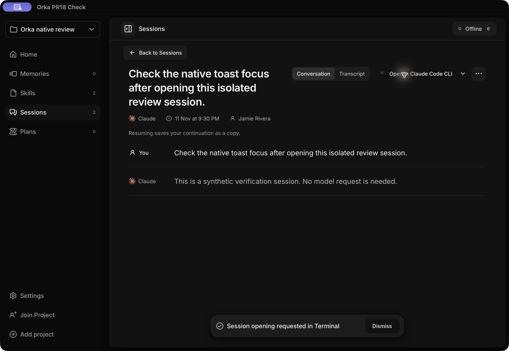

**Session reader after dismissing the toast; focus restoration was checked through native accessibility state and keyboard interaction.**

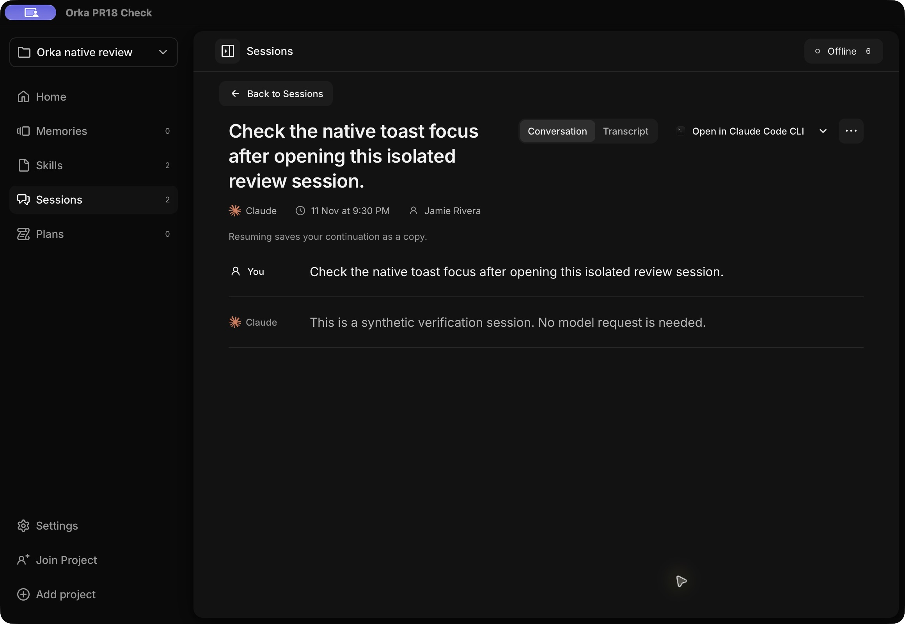

## Skill reader and change history

**Formatted Markdown with skill metadata, file list, and reader actions.**

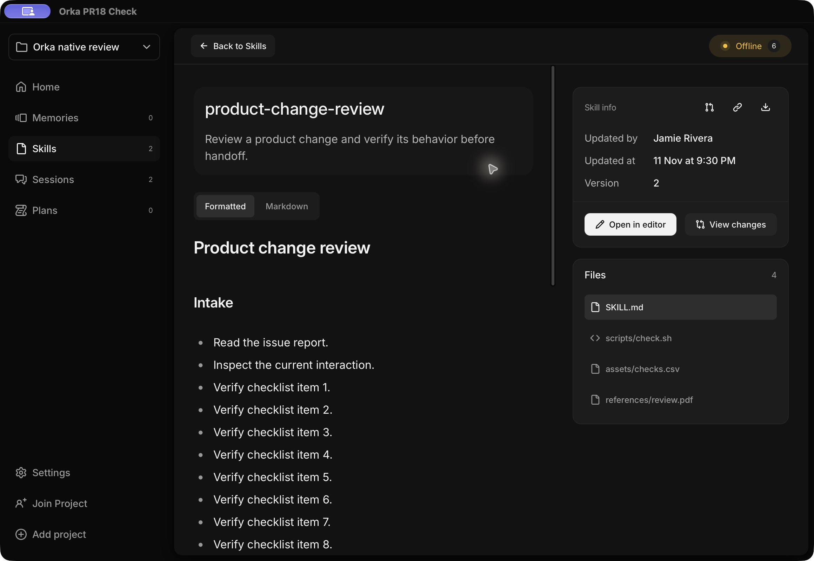

**View changes with red deletions, green additions, inline emphasis, and changed-line headers.**

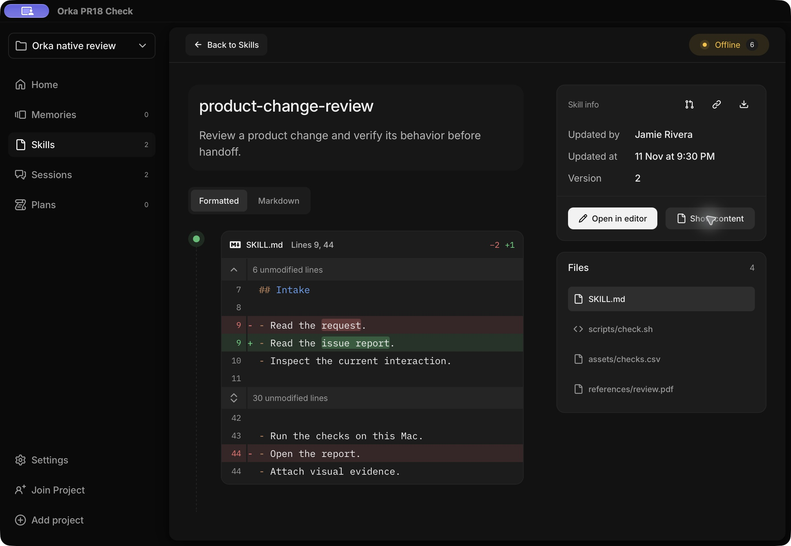

## Review local edits by access

**Can edit overlay with multiple changed files and Publish update.**

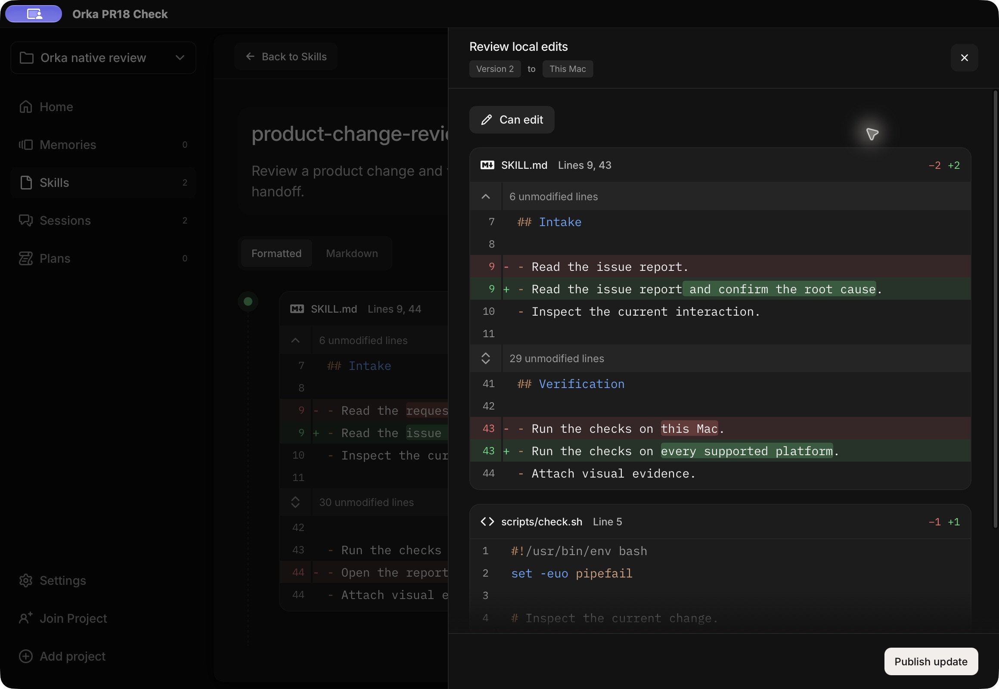

**Suggest changes overlay with multiple changed files and Send for approval.**

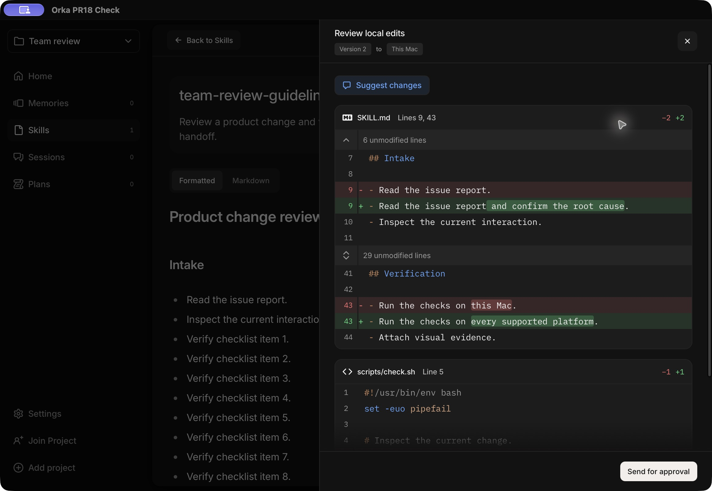

**View only overlay with access pill and diff, without a publication action.**

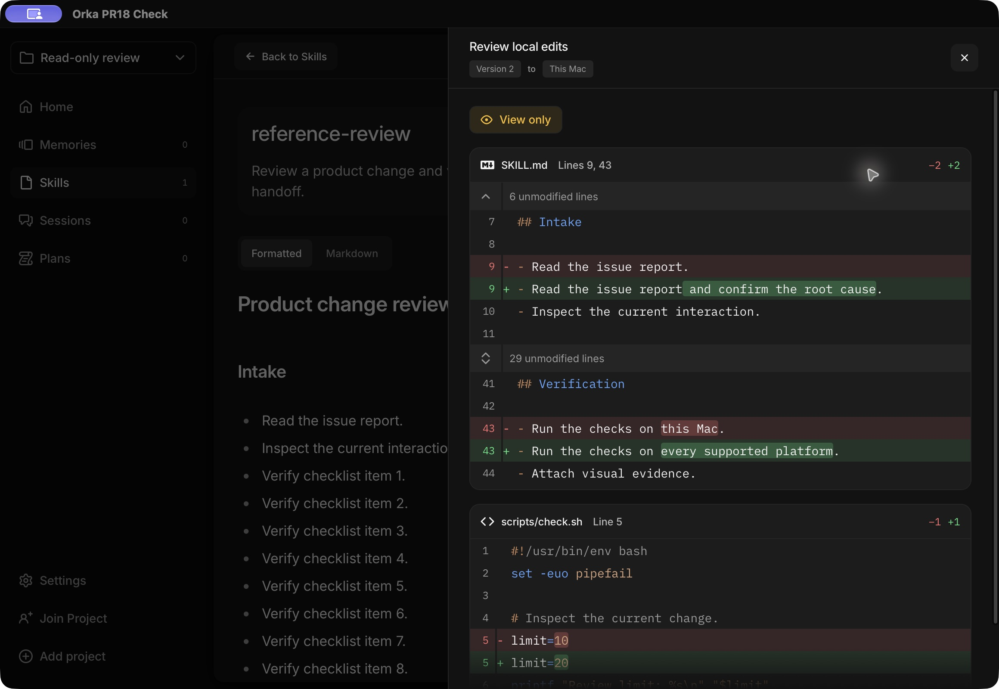

## File types

**Shell script shown as plain monospace text.**

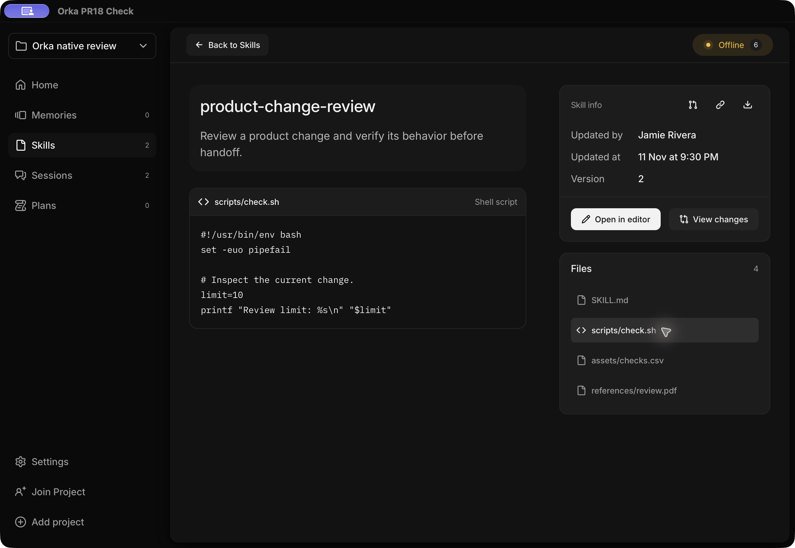

**CSV shown as raw comma-separated text.**

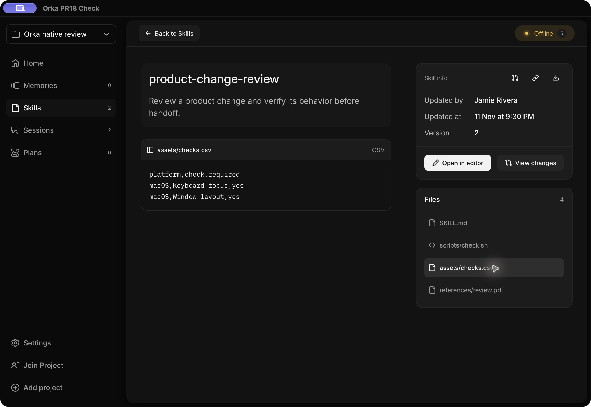

**PDF fallback with Preview unavailable and Open in editor; View changes is disabled.**

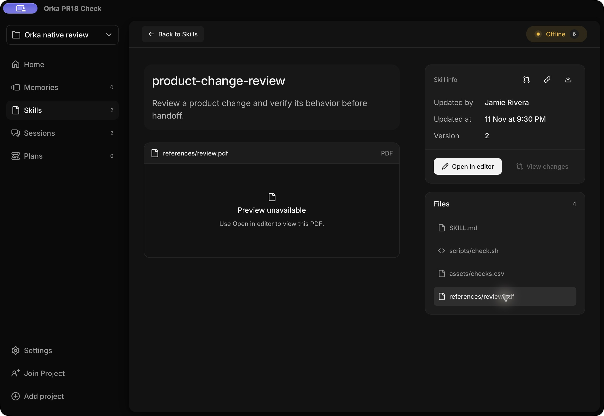

## Installed update

**Installed skill shows Version 3 after Keep edits and install.**

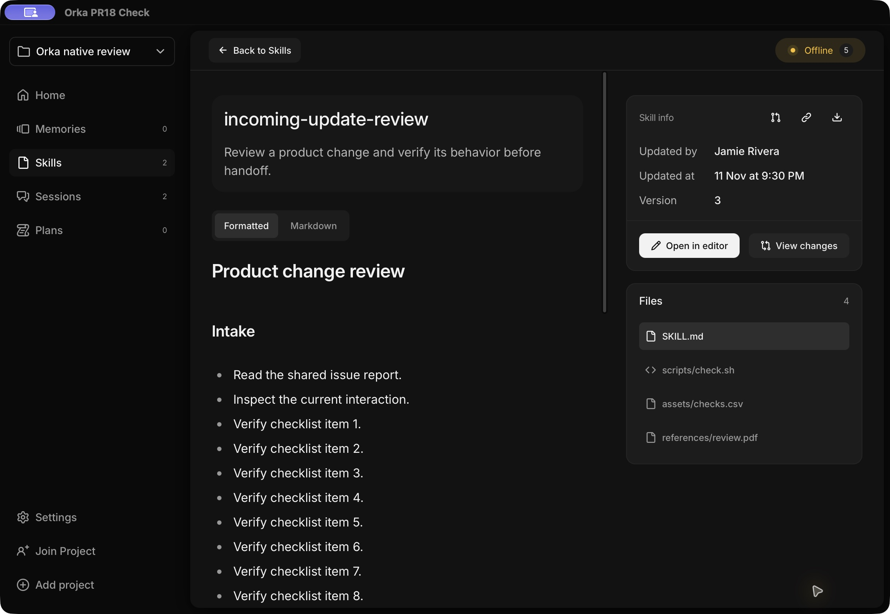

## Compact window

**Compact 900 × 640 reader with collapsed file list and document scrolling.**

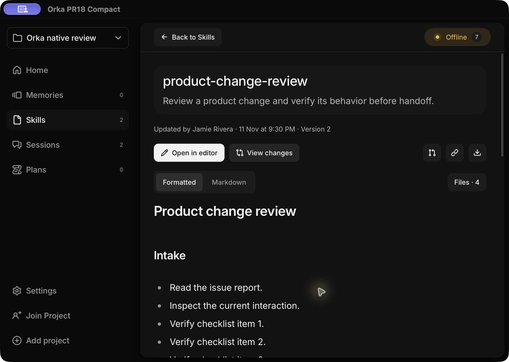

**Compact review overlay with change colors, bottom fade, and fixed Publish update action.**

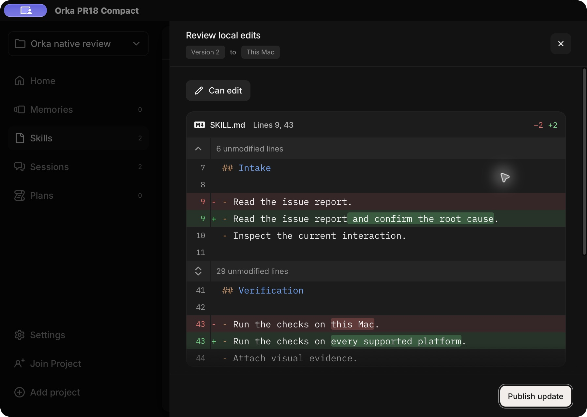

**Scrolled compact review overlay with shell syntax colors and persistent header and footer.**

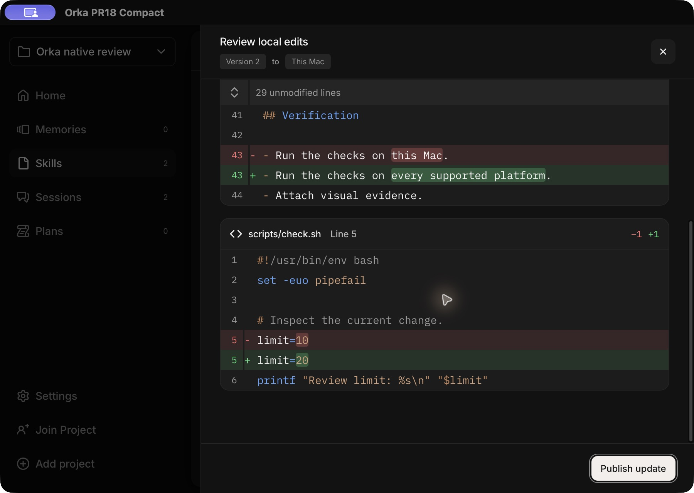

## Limitations

- Synthetic data in an isolated local profile. This is native app evidence, not live account or server verification.
- The external Claude CLI is a harmless fixture that records launch arguments. No model call or real Claude client continuation was exercised.
- Live API sync, teammate approval, Publish update, Send for approval, and external editor launch were not exercised.
- Script reader is plain monospace and CSV reader is raw text. Syntax highlighting is demonstrated in the diff views, not the script reader.
- The PDF capture verifies the fallback state, not PDF document rendering.
- Still images support visual review. Focus and installation claims also rely on native accessibility, keyboard interactions, SQLite, and file-hash checks.
- Debug, ad-hoc-signed test bundles were used. This is not a signed production release or exhaustive coverage of every application state.
