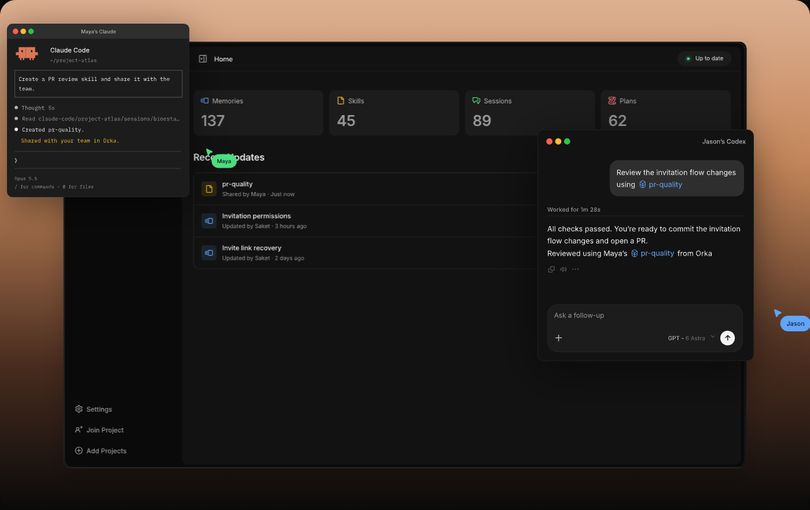
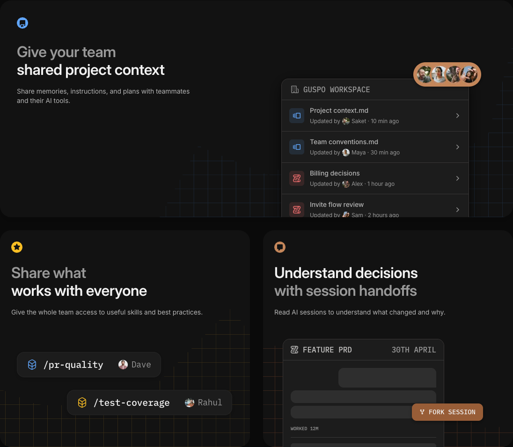

# Orka

Keep project memories, skills, plans, and coding sessions available across your Macs.

Orka is an open-source macOS desktop app for sharing project context from Codex and Claude Code through Orka Cloud or an existing compatible self-hosted service. Repository code stays in Git. You choose what to share for each project and each Mac.

[](https://tryorka.ai/)

**Status: alpha.** Requires macOS 12 or later. See [verification and limitations](docs/verification.md) before relying on native session synchronization.

## Shared context for your team

Share project memories, skills, and plans with teammates and their AI tools, and read session history to understand what changed and why.



## Features

- Group repositories into projects and filter context by repository.
- Share project instructions, attributable memories, complete skill folders, plans, and native session snapshots.
- Review proposed knowledge and permissions while keeping personal learning local.
- Resolve sync conflicts and retry changes after working offline.
- Run background sync with an adjustable interval.
- Open sessions in their native app or download a session archive.

Sharing starts disabled for new projects. Conversations can contain sensitive content; review the [data and security model](docs/security-model.md) before sharing real projects. ENV sharing is currently disabled in the desktop UI.

## Develop

Install Node.js 24+, Rust, and Apple's Command Line Tools on macOS:

```sh
git clone https://github.com/whysosaket/orka.git
cd orka
npm ci
npm run dev:profile
```

`npm run dev` starts a browser preview. The Tauri app is required for native filesystem, Keychain, and sync commands. Choose Orka Cloud or enter an existing compatible service at sign-in. See [local development](docs/development.md), [contributing](CONTRIBUTING.md), and the [design system](docs/design-system/components.md).

## Build

```sh
npm run mac
```

The app and DMG are written under `apps/mac/src-tauri/target/release/bundle/`.

[Checks](https://github.com/whysosaket/orka/actions/workflows/ci.yml) run on pull requests and pushes to `main`. [On-demand macOS build](https://github.com/whysosaket/orka/actions/workflows/release.yml) builds Apple Silicon, Intel, or universal downloads from `main`. Development builds need no Apple credentials; notarized builds require the protected signing environment. See [manual builds](docs/manual-builds.md).

## Repository scope

This repository contains the React interface, Tauri/Rust desktop application, client tests, desktop documentation, and the client integration plugin. The checksummed package in `vendor/` contains the shared protocol schemas and fixtures needed to build and test the client.

The backend implementation, database migrations, deployment tooling, server packages, and backend integration suites are maintained privately and are not part of this source release. Building the desktop and running its unit, browser, and native tests requires no private repository or registry access. Live sign-in and synchronization require a compatible running service.

This repository starts with a reviewed source snapshot and fresh Git history. Contributor attribution is preserved in [AUTHORS.md](AUTHORS.md). The existing `@portable/*` package names, native application identifiers, and Keychain identities remain stable for compatibility.

## Checks

```sh
npm run check:repository
npm run lint
npm run format:check
npm run typecheck
npm test
npm run build
npm run test:ui
npm run native:test
```

Report vulnerabilities privately using [SECURITY.md](SECURITY.md). Source is licensed under [MIT](LICENSE); dependencies and third-party assets retain their own terms in [THIRD_PARTY_NOTICES.md](THIRD_PARTY_NOTICES.md).
