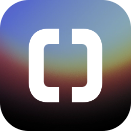

<p align="center">
  
</p>

<h1 align="center">Orka</h1>

<p align="center"><strong>Shared context for Codex and Claude Code.</strong></p>

<p align="center">
  <a href="https://github.com/whysosaket/orka/releases"></a>
  <a href="https://github.com/whysosaket/orka/actions/workflows/ci.yml"></a>
  <a href="https://github.com/whysosaket/orka/releases"></a>
  <a href="LICENSE"></a>
</p>

<p align="center">
  <a href="https://github.com/whysosaket/orka/releases"><strong>Download for macOS</strong></a> ·
  <a href="https://tryorka.ai/">Website</a> ·
  <a href="https://tryorka.ai/docs">Documentation</a>
</p>

Orka is an open-source macOS app that keeps project memories, skills, plans, and coding sessions in sync across your Macs and your team. Use Orka Cloud or your own Docker Compose server. Repository code stays in Git.

<p align="center">
  <a href="https://tryorka.ai/"></a>
</p>

## What you can do

- **Share project knowledge.** Sync instructions, memories, complete skill folders, and plans with permissions and review.
- **Keep repositories together.** Group repositories into projects and [connect GitHub](docs/github-repositories.md) to clone them onto another Mac.
- **Continue the work.** Browse shared sessions, open them in their native app, or prepare a [handoff](plugins/orka/README.md#handoffs) between tools.
- **Stay in sync.** Run background sync, retry offline changes, and resolve conflicts.

<p align="center">
  
</p>

## Get started

1. Download the universal DMG from [Releases](https://github.com/whysosaket/orka/releases), open it, and drag Orka into **Applications**. Supports Apple Silicon and Intel Macs.
2. Open Orka and choose **Orka Cloud** or **Connect to your server**.
3. Create or join a project, connect a local folder, and choose what to share.

New projects share memories, plans, and skills automatically; sessions are shared only when asked. Choices are saved per project and Mac. See [sharing controls](docs/selective-sharing.md) and the [data and security model](docs/security-model.md). ENV sharing is currently disabled in the desktop UI.

Orka is **alpha software**. Read [verification and limitations](docs/verification.md), especially for native session synchronization.

## Self-host

Run the server with Docker Compose, Git, and OpenSSL. No Orka Cloud account is required. To try it on this computer:

```sh
git clone https://github.com/whysosaket/orka.git
cd orka/server
sh ./orka-server setup --local --email you@example.com
sh ./orka-server credentials
```

Use your email as the login name; no email is sent. In Orka, choose **Connect to your server**, enter `http://127.0.0.1:8080`, and sign in with the displayed credentials. Local mode is accessible only on this computer.

Follow the [server guide](server/README.md) for prerequisites, [team hosting over HTTPS](server/README.md#run-a-server-for-your-team), [image-based installation](server/README.md#operator-releases), backups, and upgrades.

## Develop

On macOS, install Node.js 24+, Rust, and Apple's Command Line Tools:

```sh
git clone https://github.com/whysosaket/orka.git
cd orka
npm ci
npm run dev:profile
```

`npm run dev` opens a browser preview; native features require Tauri. Build the app and DMG with `npm run mac`.

[Development guide](docs/development.md) · [Contributing and checks](CONTRIBUTING.md) · [Architecture](docs/architecture.md) · [Manual builds](docs/manual-builds.md) · [Plugins](plugins/orka/README.md)

---

[MIT license](LICENSE) · [Contributors](AUTHORS.md) · [Third-party notices](THIRD_PARTY_NOTICES.md) · [Report a vulnerability](SECURITY.md)
