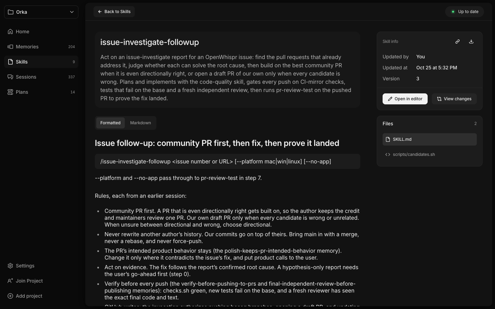
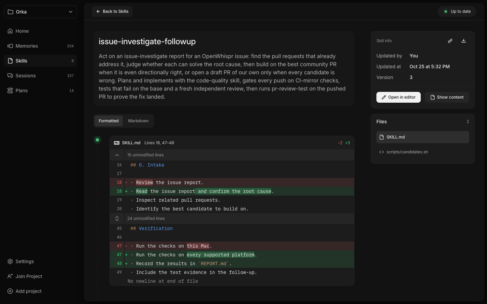
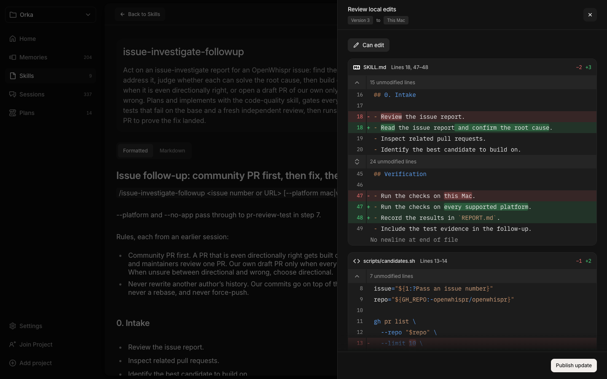
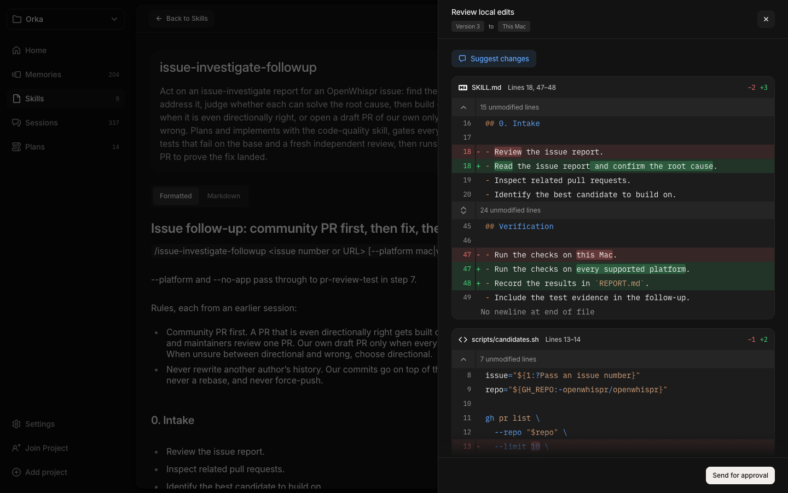
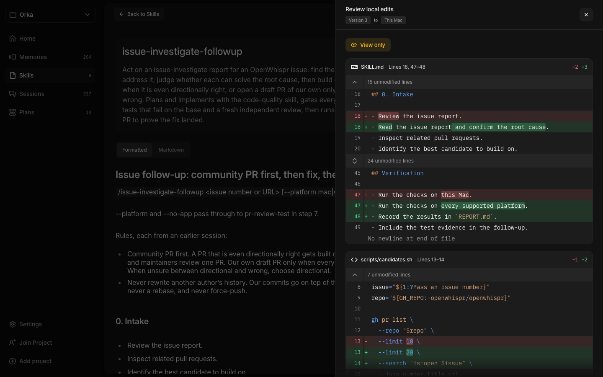
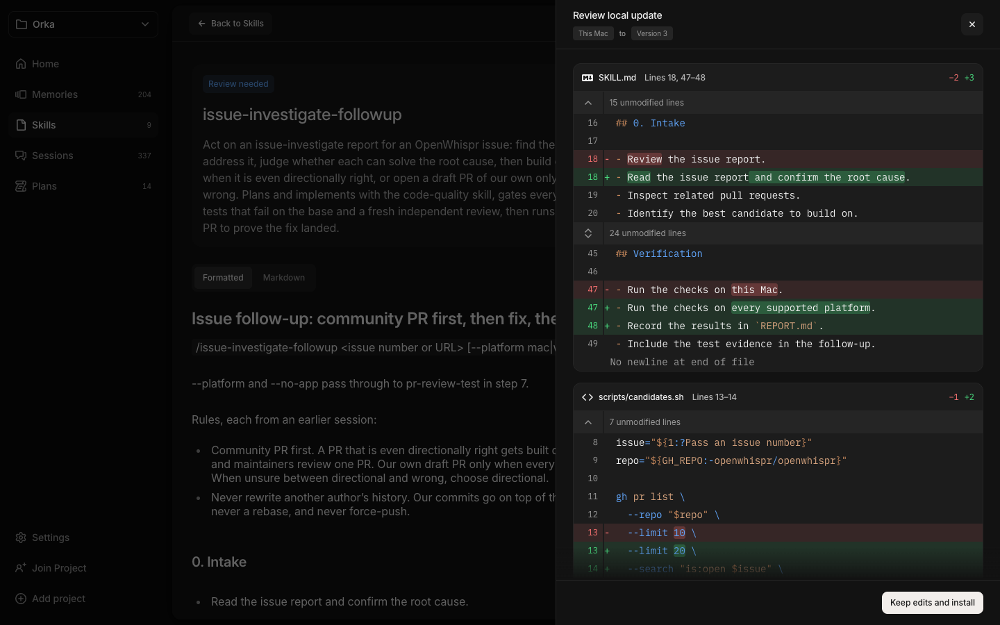
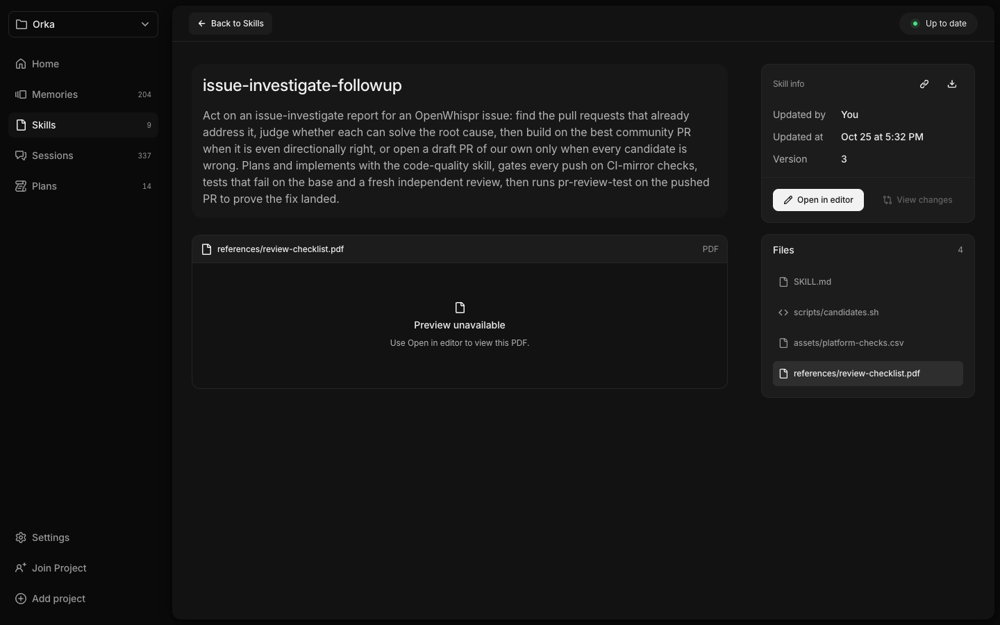

# PR #18: Skills visual evidence

Captured from the actual Orka frontend at commit [37908ed](https://github.com/whysosaket/orka/commit/37908ede1e118ff3f59975297d10c8c625c0addc).

Chromium, 1440 × 900. Native commands use deterministic test fixtures. Diffs use the actual `@pierre/diffs` renderer. These are implementation screenshots, not Figma exports.

Screenshots were captured during the validated gallery run on November 11, 2026. The gallery passed 39 checks covering 37 design states and two additional cases.

## Skill detail

Formatted Markdown, metadata, and file navigation.

## View changes

Actual Pierre diff with syntax highlighting, green additions, and red deletions.

## Local edits: Can edit

Multi-file review with Publish update.

## Local edits: Suggest changes

The same review with Send for approval.

## Local edits: View only

Access pill and diff with no publishing action.

## Incoming update

Multi-file review before Keep edits and install.

## PDF selection

Explicit preview fallback with Open in editor.

## Limits

This evidence does not establish live teammate approval, cross-Mac sync, external editor launching, or native macOS rendering. Earlier native migration screenshots are intentionally excluded. No blanket pixel-perfect claim is made.

This branch is an evidence archive. It is not part of the implementation PR or intended to be merged.
