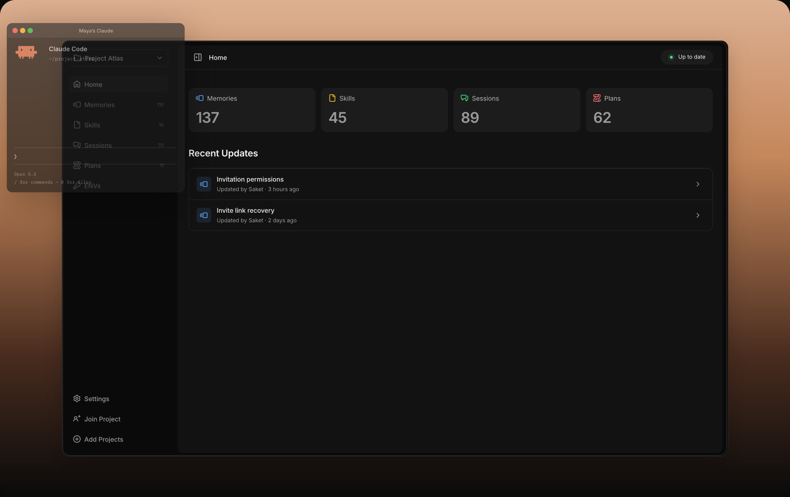
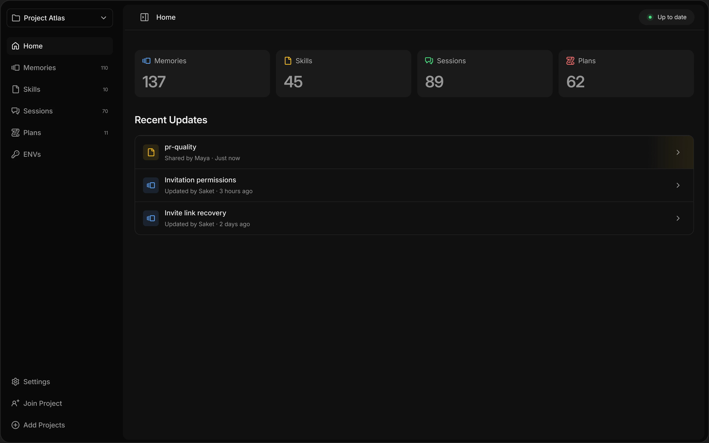

# Orka

Keep project memories, skills, plans, and coding sessions available across your Macs.

Orka is an open-source macOS desktop app for sharing project context from Codex and Claude Code through Orka Cloud or your own Docker Compose server. Repository code stays in Git. You choose what to share for each project and each Mac.

[](https://tryorka.ai/)

**Status: alpha.** The desktop app requires macOS 12 or later. The self-hosted server runs through Docker. See [verification and limitations](docs/verification.md) before relying on native session synchronization.

Download the universal DMG from [Orka releases](https://github.com/whysosaket/orka/releases),
open it and drag Orka into Applications. One installer supports Apple Silicon and Intel Macs.

## Shared context for your team

Share project memories, skills, and plans with teammates and their AI tools, and read session history to understand what changed and why.



## Features

- Group repositories into projects and filter context by repository.
- Share project instructions, attributable memories, complete skill folders, plans, and native session snapshots.
- Review proposed knowledge and permissions while keeping personal learning local.
- Resolve sync conflicts and retry changes after working offline.
- Run background sync with an adjustable interval.
- Open sessions in their native app or download a session archive.

New projects default to automatic context sharing, with sessions shared only on explicit request. Existing sharing choices are preserved. The plugins can share one selected snapshot without enabling its category; see [selected sharing](docs/selective-sharing.md). Review the [data and security model](docs/security-model.md) before sharing real projects. ENV sharing is currently disabled in the desktop UI.

## Self-host with Docker Compose

For image-based installation without Git or a source build, see the
[operator release instructions](server/README.md#operator-releases). Source
checkout setup remains available below.

Install and start [Docker Desktop](https://docs.docker.com/desktop/) or
[Docker Engine with Compose](https://docs.docker.com/engine/install/), plus Git and
OpenSSL (plus Bash/Python 3 for backups). The server runs on Linux, macOS, or Windows with WSL2. You do not need
Node.js, Rust, a Supabase account, or email/OAuth keys to run it.

### Try it on your computer

```sh
git clone https://github.com/whysosaket/orka.git
cd orka/server
sh ./orka-server setup --local --email you@example.com
sh ./orka-server credentials
```

Use your real email as the login name; no email is sent. Setup builds and starts
the server, creates your account, and checks health. The first build can take a
few minutes. `credentials` displays the saved login in your local terminal.

Open Orka on your Mac, choose **Connect to your server**, enter
`http://127.0.0.1:8080`, and sign in with the displayed email/password. Create or
connect a project and choose what to share. Local mode is only accessible on this
computer. If port 8080 is busy, repeat setup with `--port 8181`.

### Use it across your team's Macs

On your Docker server, point a real domain at the host and allow TCP 80/443.
From a fresh checkout on that host:

```sh
git clone https://github.com/whysosaket/orka.git
cd orka/server
sh ./orka-server setup --domain sync.example.com --email you@example.com
sh ./orka-server credentials
```

Replace the domain and email with yours. Setup checks HTTPS; connect every Mac
to `https://sync.example.com`. PostgreSQL, GoTrue, the API and Caddy run through
Compose with persistent storage. No Orka Cloud account or private registry is
required. Repeating setup preserves passwords and data.

### Manage the server

```sh
sh ./orka-server status
sh ./orka-server doctor
sh ./orka-server user teammate@example.com
sh ./orka-server backup
sh ./orka-server stop
sh ./orka-server start
```

The teammate command prints the private file containing their login; then invite
that account to a project from Orka. `stop` keeps all data. `backup` verifies a
restore and includes private server configuration; keep encrypted off-host copies.
After selecting a new source revision, `sh ./orka-server upgrade` verifies a backup
before rebuilding. Ordinary `start` reuses installed images without rebuilding. Keep the same directory and `.env` for this installation.
See the [server README](server/README.md) for recovery, optional providers,
troubleshooting and direct Compose commands.

## Develop the desktop

Install Node.js 24+, Rust, and Apple's Command Line Tools on macOS:

```sh
git clone https://github.com/whysosaket/orka.git
cd orka
npm ci
npm run dev:profile
```

`npm run dev` starts a browser preview. The Tauri app is required for native filesystem, Keychain, and sync commands. Choose Orka Cloud or enter an existing compatible service at sign-in. See [local development](docs/development.md), [contributing](CONTRIBUTING.md), and the [design system](docs/design-system/components.md).

## Build

```sh
npm run mac
```

The app and DMG are written under `apps/mac/src-tauri/target/release/bundle/`.

[Checks](https://github.com/whysosaket/orka/actions/workflows/ci.yml) run on pull requests and pushes to `main`. [On-demand macOS build](https://github.com/whysosaket/orka/actions/workflows/release.yml) builds Apple Silicon, Intel, or universal downloads from `main`. Development builds need no Apple credentials; notarized builds require the protected signing environment. See [manual builds](docs/manual-builds.md).

## Repository scope

This repository contains the React interface, Tauri/Rust desktop application, client tests, documentation, integration plugin, and the MIT-licensed self-hosted server source in [`server/`](server/README.md). The checksummed package in `vendor/` contains the shared protocol schemas and fixtures needed to build and test the client.

The server includes the shared API implementation, authentication adapters, database migrations, Dockerfile, Compose configuration, backup/restore tools and backend tests. It builds from this checkout without private repository or registry access. Its dependencies are separate from the desktop, which still builds and tests without a running backend.

This repository starts with a reviewed source snapshot and fresh Git history. Contributor attribution is preserved in [AUTHORS.md](AUTHORS.md). The existing `@portable/*` package names, native application identifiers, and Keychain identities remain stable for compatibility.

## Checks

```sh
npm run check:repository
npm run lint
npm run format:check
npm run typecheck
npm test
npm run build
npm run test:ui
npm run native:test
```

Report vulnerabilities privately using [SECURITY.md](SECURITY.md). Source is licensed under [MIT](LICENSE); dependencies and third-party assets retain their own terms in [THIRD_PARTY_NOTICES.md](THIRD_PARTY_NOTICES.md).
