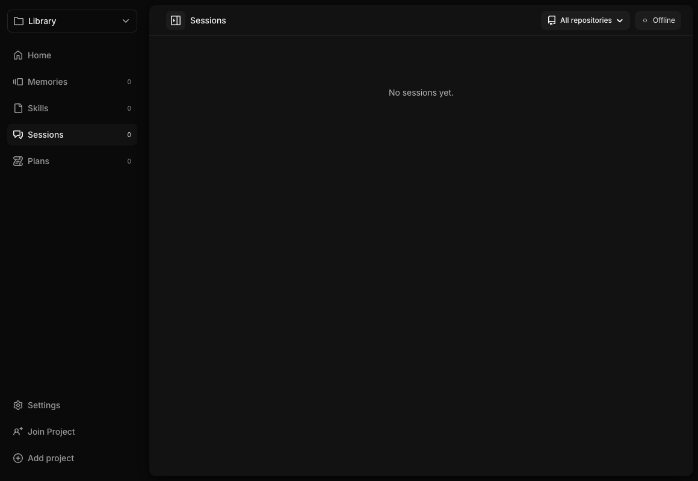
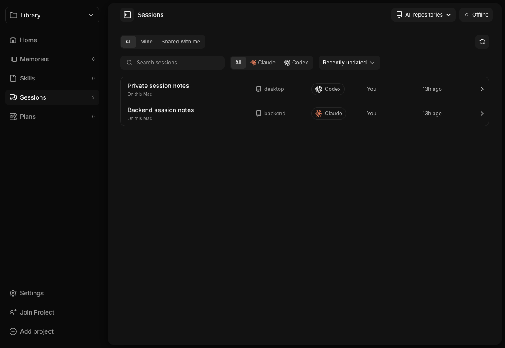
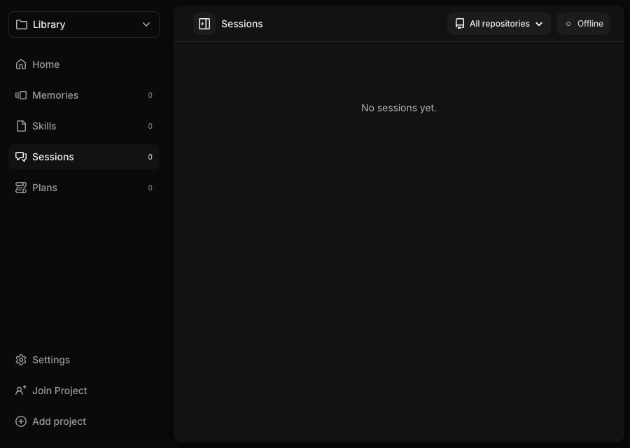
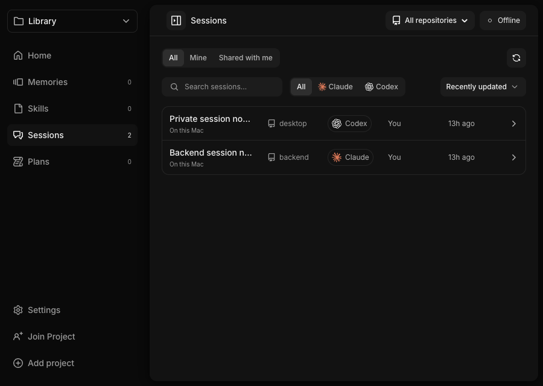
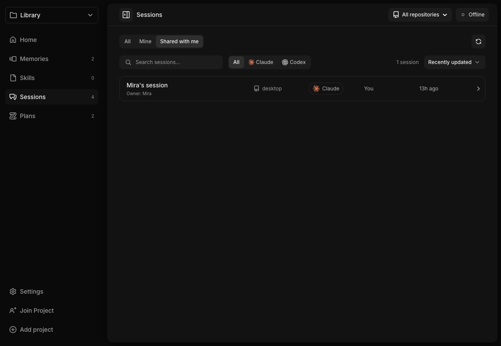

# Private resource library UI evidence

Captured on 13 November 2026 with the real desktop React components and the
synthetic Tauri bridge in `tests/ui/fixtures/resource-library.ts`.

- Before UI source: `a061f98` (main before this change).
- After UI source: `9ce8ad1`. Subsequent native-only fixes do not change these screens.
- Matching viewports: 1160×800 and 900×640, scale 1, dark desktop theme,
  reduced motion, loaded bundled fonts, no forced hover or error states.
- The development annotation toolbar is hidden on both sides.
- Private examples use the same synthetic project, two connected repositories,
  all automatic sharing categories off, offline status, and two local sessions.
  Before shows an empty shared collection; after shows the private catalog with
  All selected. The separate Shared with me image uses synthetic published
  ownership and a different last editor to demonstrate the distinction.

These browser fixtures establish rendered layout and command wiring. They do
not establish actual native indexing, Keychain, filesystem access or two-Mac
sync. Those behaviors require their separate native/acceptance checks.

## Matched sessions views

Before (1160×800):

After (1160×800):

Before (900×640):

After (900×640):

Shared with me:

